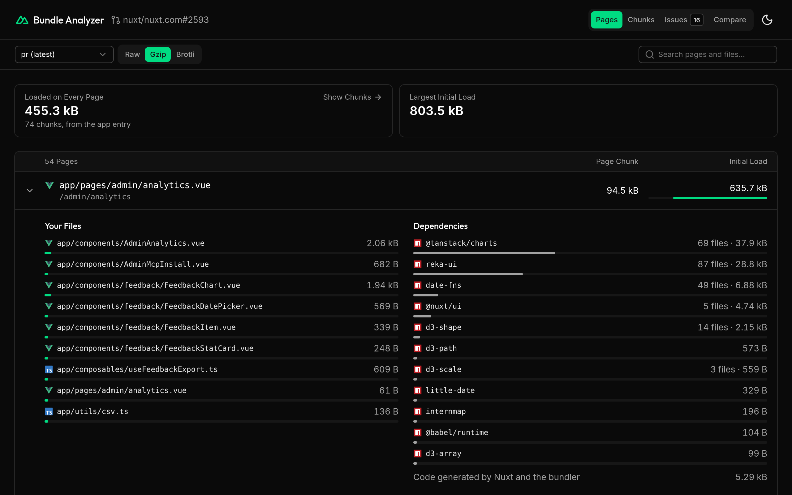
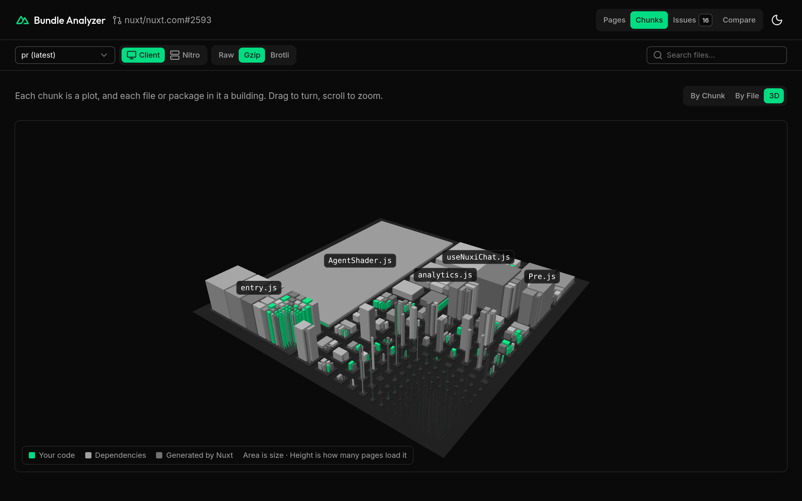
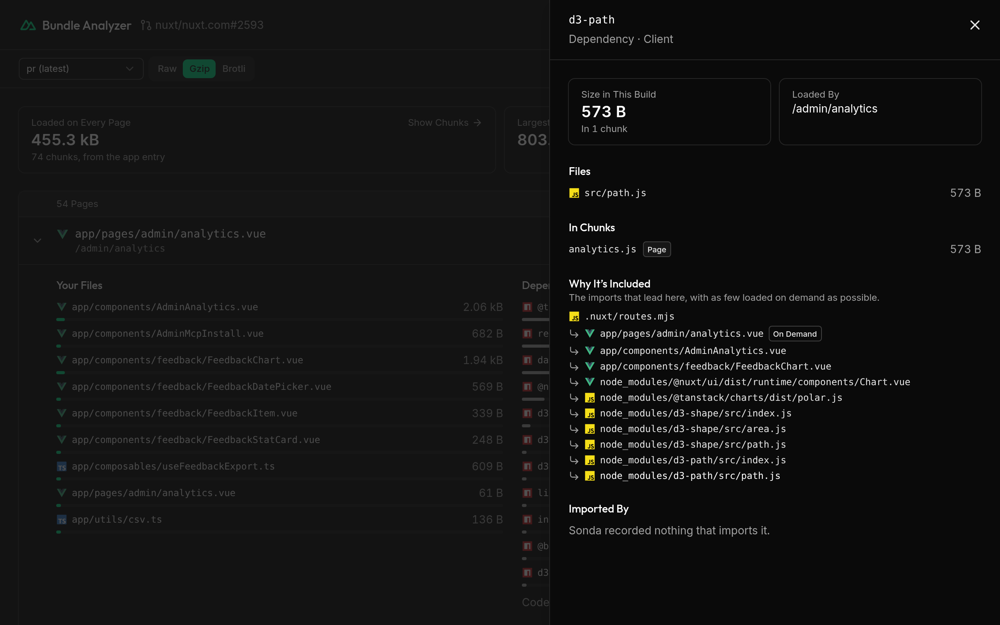
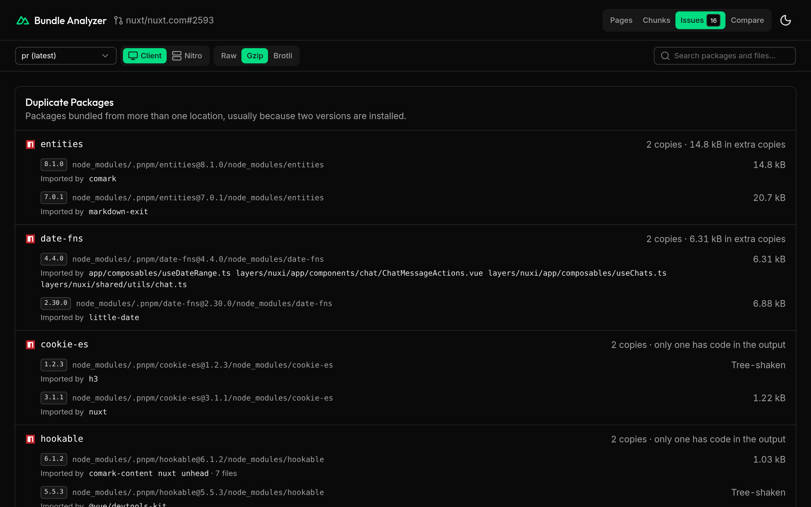
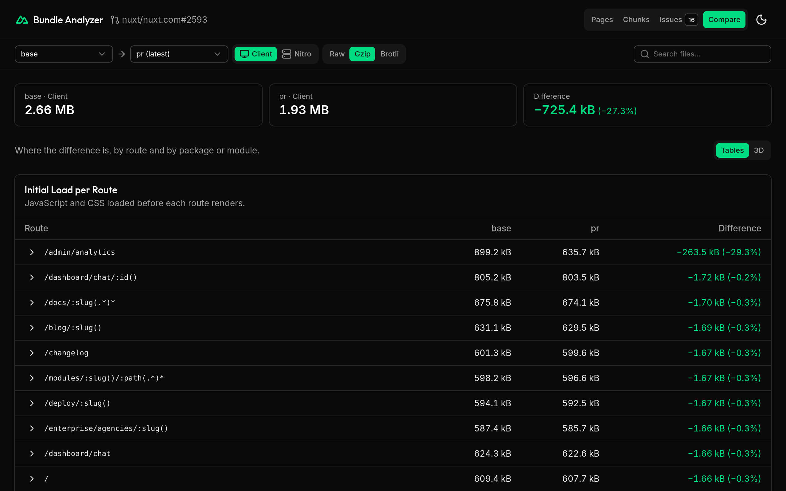

# nuxt-bundle-analyzer

See what ends up in your Nuxt bundles: each page with its size, each chunk with the files and dependencies in it, duplicate packages, circular imports, and what changed between two builds.

Sizes are measured by [Sonda](https://sonda.dev) on the final output, after minification and compression.

> [!NOTE]
> This package is experimental. Its options, the files it writes, and the upload format can change between releases.

https://github.com/user-attachments/assets/db6b95b7-0e33-4a54-9a60-69192bb6becf

[Open the online demo](https://bundle.nuxt.dev/nuxt/nuxt.com/pull/2593?view=compare&base=base&run=pr), which compares two builds of [nuxt.com](https://nuxt.com).

## Features

- **No setup:** one command builds your app for analysis and opens the analyzer. You don't install or configure anything.
- **Pages:** each page with the size of its own chunk and of everything it loads before it renders, split into your files and dependencies.
- **Chunks:** every JavaScript file of the client and Nitro builds, with the files and dependencies in it. Browse them by chunk, by file, or as a 3D city.
- **Why it's included:** pick any file or package to see its size, the chunks it's in, the chain of imports that leads to it, and what imports it.
- **Duplicate packages:** packages bundled more than once, with each version, what imports it, and the size of the extra copies.
- **Circular imports:** loops of imports, the ones through your own files first.
- **Compare two builds:** the difference for each route, package, and file, as tables or as a 3D city colored by what changed.
- **[Pull request comparisons](#comparisons-on-pull-requests):** GitHub Actions uploads both builds to a hosted viewer, so a bot comment can link to the comparison. The repository needs no secret.
- **Raw, gzip, and Brotli:** switch any view between the size on disk and the size after compression.
- **Shareable views:** the URL keeps the whole view, so you can reload it or send it to someone.

| Pages | Chunks in 3D |
| --- | --- |
|  |  |
| **Why it's included** | **Issues** |
|  |  |

## Usage

Run this in your Nuxt project:

```bash
npx nuxt-bundle-analyzer
```

It builds your app for analysis and opens the analyzer at http://localhost:3000. You don't need to install or configure anything.

## Compare two builds

Name each run, then open **Compare**:

```bash
npx nuxt-bundle-analyzer --name=before
# make your change
npx nuxt-bundle-analyzer --name=after
```

Compare shows the size difference for each route, package, and file.



## With `nuxi analyze`

To analyze every `nuxi analyze` run instead, add the module:

```bash
npx nuxt module add nuxt-bundle-analyzer
npx nuxt analyze --no-serve
npx nuxt-bundle-analyzer serve
```

Set `NUXT_BUNDLE_ANALYZER_NAME` to name these runs, or `bundleAnalyzer.name` in `nuxt.config`.

## Options

| Option | Description |
| --- | --- |
| `--name <name>` | Name of the run, so you can keep several and compare them. Defaults to `default`. |
| `--no-serve` | Write the reports without opening the analyzer. |
| `--prerender` | Prerender routes while analyzing. |
| `--extends <layer>` | Extend the app with a layer, as with `nuxi`. |
| `serve` | Open the analyzer on the runs you already have, without building. |
| `PORT` | Port of the analyzer. Defaults to `3000`. |

Runs are kept in `node_modules/.cache/nuxt-bundle-analyzer`.

> [!WARNING]
> The analysis build turns on source maps. Run `nuxt build` before you deploy.

## Comparisons on pull requests

A hosted viewer can show the comparison of a pull request, so a bot comment can link to it. GitHub Actions uploads the two runs with its OpenID Connect token: the viewer checks which repository and workflow the token comes from, so the repository needs no secret.

Pull requests from forks can't get that token, so the upload runs in a workflow triggered by `workflow_run`, which runs from the default branch:

1. The `pull_request` workflow analyzes both builds and uploads them as an artifact:

   ```yaml
   - run: npx nuxt-bundle-analyzer --name=pr --no-serve
   - uses: actions/upload-artifact@v7
     with:
       name: bundle-pr
       path: node_modules/.cache/nuxt-bundle-analyzer/pr
   ```

   Do the same for the base commit with `--name=base`.

2. The `workflow_run` workflow downloads both into `runs/base` and `runs/pr`, then uploads them:

   ```yaml
   permissions:
     actions: read
     id-token: write
     issues: write

   steps:
     - id: bundle
       run: npx nuxt-bundle-analyzer upload --runs runs --pr "$PR_NUMBER" --url https://bundle.nuxt.dev
   ```

   The step's `url` output links to the comparison, such as `https://bundle.nuxt.dev/nuxt/nuxt.com/pull/1234?view=compare&base=base&run=pr`. Add it to the comment.

Each upload replaces the previous one for that pull request.

## Hosting the viewer

[](https://vercel.com/new/clone?repository-url=https%3A%2F%2Fgithub.com%2Fatinux%2Fnuxt-bundle-analyzer%2Ftree%2Fmain%2Fviewer&project-name=nuxt-bundle-analyzer&repository-name=nuxt-bundle-analyzer-viewer&env=NUXT_OIDC_ALLOWED_WORKFLOWS&envDescription=Comma-separated%20workflows%20allowed%20to%20upload%2C%20as%20owner%2Frepo%2F.github%2Fworkflows%2F%3Cfile%3E%40%3Cref%3E&envLink=https%3A%2F%2Fgithub.com%2Fatinux%2Fnuxt-bundle-analyzer%23hosting-the-viewer&stores=%5B%7B%22type%22%3A%22blob%22%2C%22access%22%3A%22public%22%7D%5D)

The viewer is the Nuxt app in `viewer/`. The button copies it into a new repository, then deploys it on Vercel with a public Blob store for the reports. To deploy this repository instead, use `viewer` as the root directory and connect a public Blob store to the project.

Either way, set which workflows may upload, as `owner/repo/.github/workflows/<file>@<ref>`:

```bash
NUXT_OIDC_ALLOWED_WORKFLOWS=nuxt/nuxt.com/.github/workflows/bundle-size-comment.yml@refs/heads/main
```

Only a workflow on that ref can upload, so a pull request that edits the workflow can't. Uploads are stored under the repository named in the token, whatever the request says. The viewer checks every file before storing it, as the reports come from a build of the pull request's code.

Stored reports are public: allow only public repositories.

## Development

```bash
pnpm install
pnpm build        # the viewer, the module and the command
pnpm test
cd playground && node ../dist/cli.mjs
```

Run `pnpm dev:viewer` with `ANALYZE_SERVER` pointing at a running `nuxt-bundle-analyzer serve` to work on the viewer.

## Releasing

Releases go through [uppt](https://github.com/danielroe/uppt) and npm [trusted publishing](https://docs.npmjs.com/trusted-publishers), so no npm token is stored:

1. Every push to `main` opens or updates a draft release PR, with the version bump and changelog from conventional commits.
2. Merging that PR tags the release, creates the GitHub release, and builds the package.
3. The publish job waits for a maintainer to approve it in the `npm` environment, then stages the version on npm with provenance.
4. The version goes live once a maintainer approves it with 2FA, in the **Staged Packages** tab on npmjs.com.
